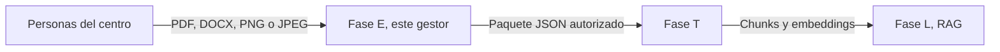
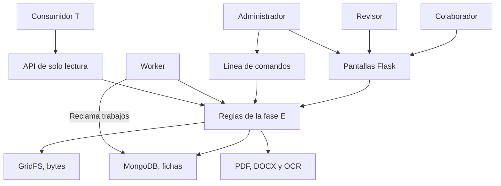
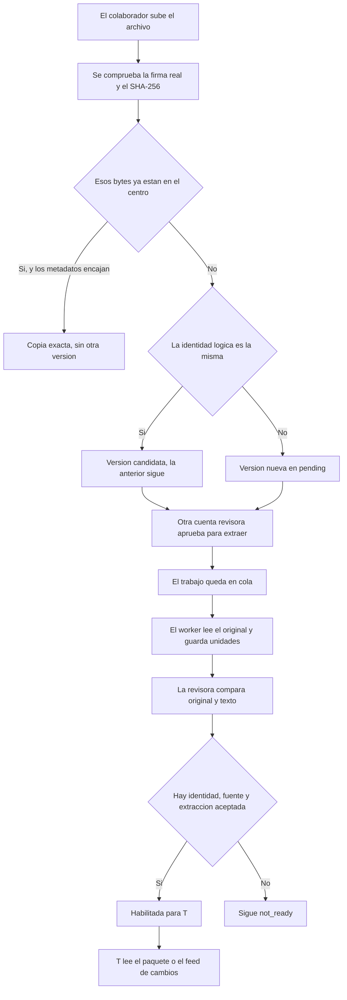
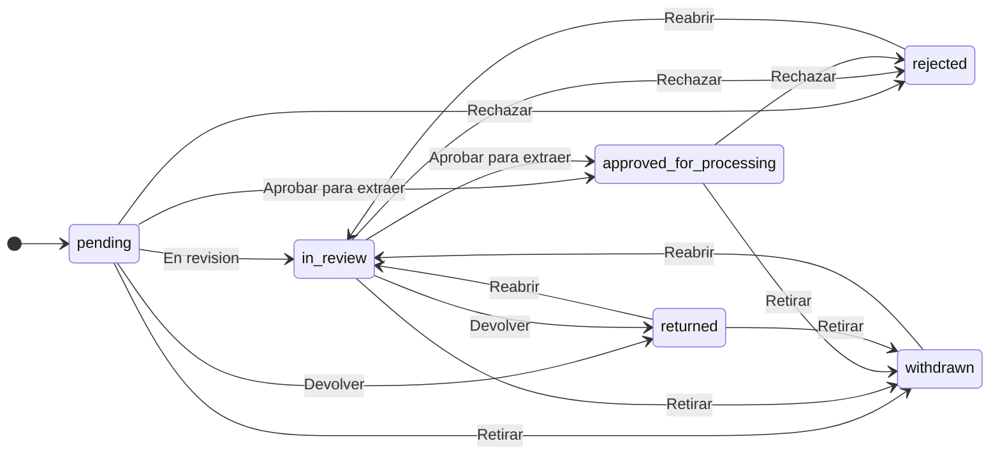
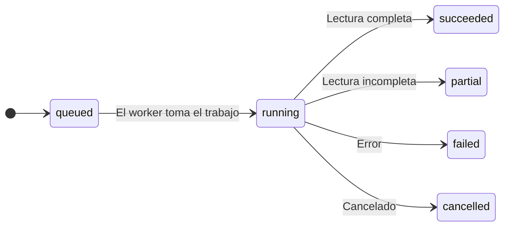
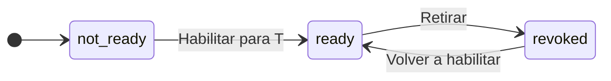
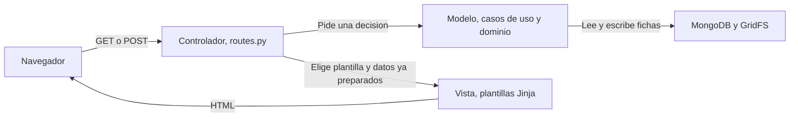
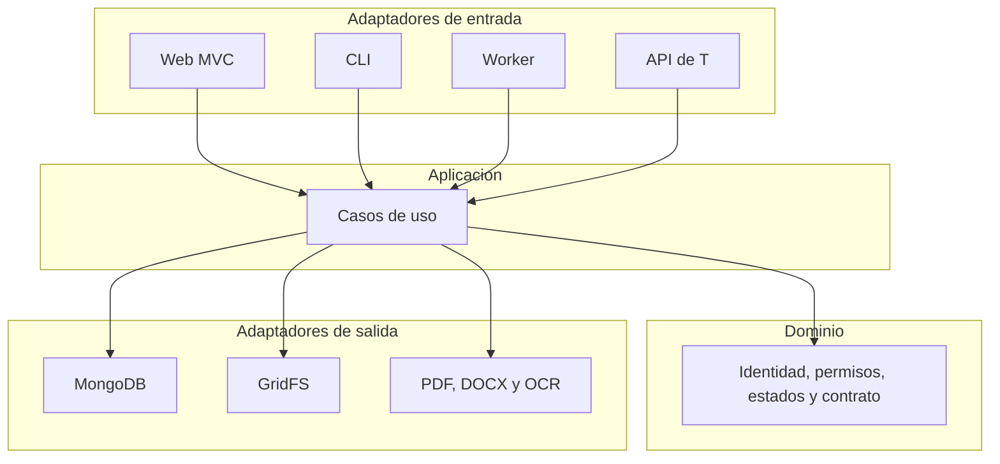
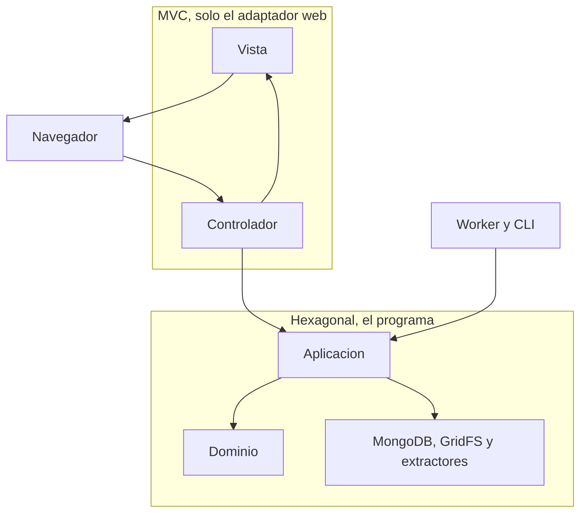

# Gestor de extracción DocIA+ (fase E)

Aplicación de aula del curso de especialización en Inteligencia Artificial y Big Data del IES Ataúlfo Argenta. Implementa la fase **E** del ETL de DocIA+: incorporar un documento, conservar el original, leerlo en local, revisarlo con una persona y, solo si esa persona lo autoriza, entregarlo a la fase **T**.

Este repositorio es la aplicación. No incluye las memorias de los grupos, vídeos ni documentos reales del centro.

Perfil inicial: `actividades_orientacion` (actividades y orientación general del Grupo 5). Tecnologías fijadas: Python 3.12, Flask, MVC en la interfaz, arquitectura hexagonal en el núcleo, MongoDB y GridFS.

## Qué problema resuelve

DocIA+ quiere un corpus de documentos del centro para consultarlos después con un RAG. Antes de trocear textos y calcular embeddings hay que saber **qué documento es**, **de dónde sale**, **si se puede usar** y **qué texto se ha leído de verdad**.

Esa primera parte es la extracción. Si se mezcla con el RAG, un archivo subido parecería ya publicado. Esta aplicación separa las dos cosas:

| Fase | Qué hace | ¿Está en este repositorio? |
|---|---|---|
| E | Recibir, guardar el original, extraer, revisar y autorizar | Sí |
| T | Limpiar, crear chunks y embeddings | No |
| L | Índice vectorial y consulta | No |

Habilitar para T **no** crea vectores, **no** llama a un modelo y **no** publica nada en un chatbot. Deja un paquete JSON que otra fase podrá leer.

## Qué se ha construido

Una aplicación web, un worker aparte y una API de solo lectura para el consumidor T.

1. **Cuentas y permisos.** No hay registro público. Las cuentas las crea un administrador con la CLI. Un colaborador no aprueba. Un revisor no aprueba su propia aportación. El permiso depende del centro, no solo del rol.
2. **Alta de documentos.** PDF, DOCX, PNG y JPEG. Se comprueba el contenido real, no solo la extensión ni el tipo que dice el navegador. El original no se modifica.
3. **Hash SHA-256 en streaming.** Identifica bytes iguales. No acredita autoría, oficialidad ni permiso para difundir.
4. **Duplicados y versiones.** El mismo archivo con otro nombre no crea otra versión. Otros bytes de la misma actividad sí crean una candidata, pero no sustituyen la anterior solos.
5. **Extracción local.** PDF digital con pypdf, DOCX con python-docx en el orden del cuerpo, imágenes y PDF escaneado con Tesseract si el idioma español está instalado. No hace falta un LLM ni Docling.
6. **Worker durable.** La extracción no corre dentro de la petición HTTP. Si se cierra el navegador, el trabajo sigue en MongoDB.
7. **Revisión humana.** Quien revisa ve el original, el texto, las incidencias y el motivo de cada decisión.
8. **Entrega a T.** Solo sale un paquete si la extracción está completa, revisada y expresamente autorizada. Retirarla deja de ofrecerla y avisa por un feed de cambios.
9. **Copias.** Se puede pausar el sistema, copiar la base y GridFS a **otra** base y comprobar conteos.

## Qué no hace, a propósito

- No crea chunks, embeddings, ChromaDB ni `/api/rag/chunks`.
- No descarga las URL que se escriben como fuente. Guardar la URL no es rastrear la web.
- No guarda contraseñas de PDF ni intenta saltarse un cifrado.
- No corrige a mano el texto del OCR. Si la lectura es mala, se reextrae o se pide otra copia.
- No trata un patrón automático como prueba de que el texto está anonimizado.
- No mezcla en un solo estado el permiso, el OCR y si la actividad está confirmada o cancelada.

Los bloques binarios de GridFS (`docia_blobs.chunks`) y las unidades de lectura de esta fase **no son** los futuros chunks del RAG. Un chunk semántico lo decidirá T.

## Decisiones que ya están tomadas

No hace falta volver a elegirlas para arrancar el proyecto.

- **Python 3.12** es la base del aula. En el equipo donde se preparó el repositorio el Python del sistema era 3.9.6; el entorno del proyecto usa 3.12.15.
- **Flask, Jinja, HTML y CSS.** La interfaz es responsive. No es una app nativa ni una PWA que cachee documentos.
- **MVC y hexagonal a la vez.** MVC organiza la pantalla. Hexagonal impide que las reglas de negocio importen Flask, PyMongo o Tesseract. Cambiar el extractor no debe cambiar quién puede aprobar.
- **MongoDB y GridFS** los eligió el docente. La memoria del Grupo 5 permitía elegir la base; no imponía esta. MongoDB guarda fichas. GridFS guarda bytes.
- **Replica set de un nodo.** No da alta disponibilidad. Sirve para que el catálogo pueda usar transacciones en local. GridFS no entra en esa transacción: primero se escribe el archivo y se comprueba el hash; después una transacción corta enlaza la ficha. Si el enlace falla, el archivo no queda listo.
- **URI:** `mongodb://127.0.0.1:27017/?replicaSet=rs0`. No se usa `directConnection=true`, porque ese flag oculta el replica set y las transacciones dejan de funcionar. El diagnóstico avisa si alguien lo añade.
- **Identidad de una actividad:** centro + identificador estable del evento + edición o curso. Cambiar la fecha no crea otro evento. Repetir la actividad otro año sí es otra edición.
- **Orientación:** solo guías y procedimientos generales. Expedientes, entrevistas, diagnósticos, listas nominativas y recomendaciones individualizadas quedan fuera.
- **Límites de partida, no de producción:** 25 MiB por archivo (1 MiB = 1 048 576 bytes), 100 páginas PDF, 30 megapíxeles, 60 segundos de OCR por página y 15 minutos por trabajo. No se han medido como capacidad real del aula.

El detalle del modelo está en [docs/modelo.md](docs/modelo.md). El origen de estas decisiones, frente a las memorias de los grupos, está explicado más abajo.

## Esquemas de funcionamiento

La aplicación hace una sola cosa, partida en pasos que no se saltan: guardar el original, leerlo en local, dejar que una persona lo revise y, solo entonces, ofrecer un paquete a la fase T.



La flecha hacia T solo existe cuando un revisor pulsa «habilitar para T». Subir el archivo, terminar el OCR o aceptar el texto no crean esa flecha. La fase L no está en este repositorio.

Dentro de la fase E hay cuatro entradas y el mismo núcleo. La web y la línea de comandos las usa el aula. El worker trabaja solo. El consumidor T solo lee.



### Camino de un archivo



El hash solo dice que los bytes coinciden. Una copia exacta no es una versión nueva. Una versión nueva no es una extracción. Una extracción aceptada no confirma el evento ni publica nada en un RAG.

### Tres estados independientes

Un documento no tiene «un estado». Tiene tres, y cada uno responde a una pregunta distinta.



Ese diagrama es el permiso documental. Sale de `_DOC_TRANSITIONS` en `src/docia_e/domain/policies.py`. Reabrir un rechazo vuelve a revisión. No salta a aprobado.



Ese es el trabajo técnico. Al terminar, la revisión de esa lectura sigue en `unreviewed` hasta que una persona la acepte o la rechace. Aceptarla no cambia `planned` a `confirmed`.



La entrega es la tercera máquina. `ready` es lo único que ve T. `revoked` deja de ofrecer el paquete y deja constancia en el feed, ordenado por secuencia.

## MVC y arquitectura hexagonal

La interfaz usa MVC. El programa entero usa una arquitectura hexagonal pragmática. No son dos formas rivales de hacer lo mismo: cada una ordena una capa distinta.

### Qué es MVC

MVC reparte una aplicación interactiva en tres responsabilidades.

| Pieza | Pregunta que responde | En este proyecto |
|---|---|---|
| Modelo | Qué datos hay y qué reglas valen | Casos de uso, dominio, MongoDB y GridFS |
| Vista | Cómo se muestra | Plantillas Jinja, CSS y el JSON de la API |
| Controlador | Qué petición ha llegado y qué hay que hacer | `src/docia_e/adapters/web/routes.py` |

El navegador no habla con MongoDB. Habla con una ruta. La ruta no decide si alguien puede aprobar su propio documento: llama a un caso de uso y, con el resultado, elige una plantilla o un error.



Un ejemplo concreto: `POST /versions/<id>/review`.

1. La vista es el formulario de la ficha.
2. El controlador comprueba la sesión, el token CSRF y qué botón se ha pulsado.
3. El modelo aplica la transición, el centro y la prohibición de aprobar la propia aportación.
4. El controlador redirige a la ficha o pinta el error. La plantilla no consulta la base.

La API de T es otra vista del mismo modelo: en vez de HTML devuelve JSON, y entra con un token Bearer en lugar de una cookie.

### Qué es la arquitectura hexagonal

La arquitectura hexagonal, o de puertos y adaptadores, pone las reglas en el centro y deja fuera todo lo que puede cambiar: el marco web, la base de datos y los programas que leen PDF.

- El **dominio** sabe qué es una actividad, qué transición es legal y cuándo se puede entregar a T.
- La **aplicación** ordena los casos de uso: recibir, revisar, extraer, habilitar.
- Un **adaptador de entrada** traduce el mundo exterior a una llamada. La web, la CLI, el worker y la API son adaptadores de entrada.
- Un **adaptador de salida** habla con una tecnología. MongoDB, GridFS y los extractores son adaptadores de salida.

La dependencia apunta hacia dentro. Flask puede conocer un caso de uso. El dominio no importa Flask, PyMongo ni Tesseract. Así, cambiar la pantalla no reescribe quién puede aprobar, y cambiar MongoDB no reescribe la identidad de una actividad.



En el código esa idea se ve así:

```text
gestor_extraccion_docia/
  src/docia_e/
    domain/                 reglas, estados, identidad, contrato JSON
    application/            casos de uso: alta, revisión, extracción, entrega
    adapters/
      web/                  controlador, plantillas, CSS y seguridad
      persistence/          MongoDB, índices y transacciones
      storage/              GridFS
      extraction/           validación de archivos y parsers
      jobs/                 worker
    cli.py                  usuarios, índices, diagnóstico, copias
  tests/                    pruebas de dominio sin Mongo ni Tesseract
  docs/                     modelo, demostración y OpenAPI
  compose.yaml              MongoDB 7.0.14, solo en 127.0.0.1
  .env.example              variables, sin secretos
```

Los casos de uso reciben el catálogo y el almacén de archivos como argumentos. No abren ellos la conexión. Hay una excepción de aula: `uploads.py` y `extractions.py` importan el adaptador de extracción. El puerto del parser todavía no es una interfaz separada. Las reglas de permiso, identidad y entrega siguen en `domain/` y no conocen esa librería.

### Cómo encajan las dos

MVC ordena la entrada web. Hexagonal ordena el programa.



El controlador es, a la vez, el controlador de MVC y un adaptador de entrada del hexágono. El «modelo» de MVC no es una sola clase: por dentro está partido en dominio y adaptadores de salida, para que una plantilla no acabe con consultas ni con reglas de negocio.

### Ventajas de estructurarlo así

- **La pantalla se puede cambiar sin tocar la regla.** Un botón nuevo pasa por el controlador. Quién puede pulsarlo ya está escrito en el dominio.
- **La misma regla sirve para varias entradas.** La web, el worker y la CLI no copian el criterio de «listo para T». Llaman al mismo caso de uso.
- **Las pruebas de negocio no necesitan Docker ni Tesseract.** Identidad, transiciones y el contrato JSON se prueban con diccionarios. Por eso `pytest` puede pasar aunque MongoDB esté parado.
- **Un fallo de infraestructura no se disfraza de dato guardado.** Si MongoDB no responde, el controlador traduce ese fallo a un error de servicio. El formulario no aparece como aceptado.
- **Se puede sustituir una tecnología por el borde.** Otro lector de PDF, u otra base, se enchufa como adaptador. La identidad «centro + evento + edición» no vive dentro de GridFS.
- **El alumnado sabe dónde mirar.** Una duda de permiso se abre en `domain/policies.py`. Una duda de HTML se abre en `adapters/web/templates/`. Una duda de índice se abre en `adapters/persistence/`.

## Recorrido de un documento

1. Una cuenta colaboradora entra y sube un archivo con familia, centro, título y fuente. **Subir no habilita para T.**
2. El servidor guarda el archivo en un temporal privado, calcula el SHA-256 por bloques y comprueba la firma real.
3. Si esos mismos bytes ya estaban en el centro y los metadatos encajan, responde **copia exacta**. No hay otra versión ni otro trabajo.
4. Si los bytes son distintos pero la identidad lógica es la misma, crea una **candidata**. La anterior sigue vigente hasta que un revisor decida.
5. Otra cuenta revisora aprueba el documento **para extraer**. Quien lo subió no puede hacerlo.
6. El worker lee el original y guarda unidades con localizador: página de PDF, bloque de DOCX o imagen. Terminar el parser solo cambia el estado técnico.
7. La revisora compara original y texto. Aceptar la extracción **no** pasa una actividad de prevista a confirmada.
8. Si hay identidad, fuente, audiencia, fecha cuando hace falta y una extracción aceptada, se habilita la entrega.
9. El consumidor T descarga el paquete o se entera de una retirada por `/api/etl/v1/changes`. El orden lo marca una secuencia, no la hora, para no perder dos cambios del mismo segundo.

## Roles

| Rol | Puede | No puede |
|---|---|---|
| Colaborador | Crear aportaciones, ver las suyas y el catálogo ya autorizado, pedir extracción cuando el documento esté autorizado | Ver pendientes ajenos ni aprobar |
| Revisor | Revisar, devolver, rechazar, autorizar la extracción, resolver relaciones, habilitar T y retirar | Aprobar su propia aportación |
| Administrador | Usuarios, diagnóstico y copias | Aprobar documentos, salvo que también sea revisor |
| Consumidor T | Leer entregas autorizadas y el feed de cambios de su centro | Modificar fichas |

La demostración exige **dos cuentas distintas**: quien aporta y quien revisa.

## Tres estados que no se mezclan

Los diagramas de la sección anterior son estos tres estados. El documental responde si la versión se puede extraer. El técnico responde si el worker ha leído el archivo. La entrega responde si T puede descargarla.

La revisión del texto (`unreviewed`, `accepted`, `rejected`) no es un cuarto estado del documento: cuelga de una extracción concreta. El estado del evento (`planned`, `confirmed`, `cancelled`…) tampoco se mezcla. Una cancelación no se borra ni se convierte en una invitación nueva. Puede entregarse a T como aviso, con ese estado escrito en el paquete.

## Reglas que cualquier cambio debe respetar

1. Cargar no es aprobar. Extraer no es revisar. Listo para T no es publicado en el RAG.
2. Documento, versión, archivo, extracción y entrega tienen identidades distintas. Reprocesar un original crea otra extracción, no otra versión.
3. No se inventan fechas, páginas ni texto ilegible. Si falta un dato, queda nulo o pendiente.
4. Si falta la fecha de una actividad, se puede registrar y extraer, pero no habilitar T.
5. Una alerta de privacidad bloquea la entrega hasta que una persona la mire.
6. Los documentos son datos. No se ejecutan macros, no se siguen enlaces del DOCX y un `<script>` dentro del texto se muestra como texto.
7. Dos revisores no pueden dejar dos entregas principales activas de la misma identidad. Si hay conflicto, la respuesta es 409 y hay que recargar la ficha.

## De las memorias al alcance de esta entrega

Las memorias de los cinco grupos describían un camino hasta el RAG. Aquí el camino se corta en E y «publicar» pasa a ser «autorizar la entrega a T».

| Grupo | Qué se conserva |
|---|---|
| Programaciones | Identidad por centro, módulo y curso; copia exacta; sustitución controlada |
| PEC | Documento lógico distinto de sus versiones; fechas desconocidas; anexos como complementos |
| Planes | Tipos de plan y periodos que no se mezclan |
| Oferta | Distinguir oferta, admisión y plazas; no resolver contradicciones solos |
| Actividades y orientación | Perfil principal, temporalidad, privacidad, revisión y auditoría |

PDF, DOCX y escaneos son obligatorios en esta entrega, aunque varias memorias dejaban el DOCX como ampliación. El identificador estable de evento se añade para que cambiar la fecha no cambie la identidad sin querer.

## Instalación

Hace falta Python 3.12, Docker Desktop y, para OCR, Tesseract con español. `pip install pytesseract` **no** instala el programa Tesseract.

En el equipo del docente se comprobó el arranque en macOS Apple Silicon: Docker Desktop, imagen `mongo:7.0.14`, replica set `rs0`, transacción de catálogo, índices, web y worker. El OCR quedó pendiente porque Tesseract no estaba instalado. Los comandos de Windows y Ubuntu están escritos para el aula y no se ejecutaron en esos sistemas.

### macOS (zsh)

```zsh
brew install python@3.12 tesseract tesseract-lang
tesseract --list-langs

git clone https://github.com/iesataulfoargentasor/gestor-extraccion-docia.git
cd gestor-extraccion-docia
python3.12 -m venv .venv
source .venv/bin/activate
pip install -e ".[dev]"
cp .env.example .env
python -c 'import secrets; print("SECRET_KEY=" + secrets.token_urlsafe(48))' >> .env
```

Con Docker Desktop ya abierto:

```zsh
docker compose up -d
sh scripts/init-replica.sh
```

La imagen está fijada en `mongo:7.0.14`. El puerto de Mongo solo se publica en `127.0.0.1`. No lo abráis a la red del aula para que un móvil se conecte directo a la base.

### Windows 11 (PowerShell)

```powershell
py -3.12 -m venv .venv
.\.venv\Scripts\Activate.ps1
pip install -e ".[dev]"
Copy-Item .env.example .env
python -c "import secrets; print('SECRET_KEY=' + secrets.token_urlsafe(48))" | Add-Content .env
docker compose up -d
docker compose exec -T mongodb mongosh --quiet --eval "try { if (rs.status().ok) { quit(0); } } catch (e) { rs.initiate({_id: 'rs0', members: [{_id: 0, host: '127.0.0.1:27017'}]}); }"
```

Tesseract en Windows se instala con su instalador y el idioma `spa`. Comprobad `tesseract --list-langs`.

### Ubuntu 22.04

```bash
sudo apt update
sudo apt install -y python3.12 python3.12-venv tesseract-ocr tesseract-ocr-spa
python3.12 -m venv .venv
source .venv/bin/activate
pip install -e ".[dev]"
cp .env.example .env
python -c 'import secrets; print("SECRET_KEY=" + secrets.token_urlsafe(48))' >> .env
tesseract --list-langs
docker compose up -d
sh scripts/init-replica.sh
```

Las versiones de Python que se usaron al preparar el proyecto están en `requirements.lock`.

## Arranque

Hacen falta dos procesos. La web no hace OCR en la petición.

```zsh
source .venv/bin/activate
docia-e init-indexes
DOC_USER_PASSWORD='una-clave-larga' docia-e create-user --login colaborador --roles collaborator --centers centro-demo
DOC_USER_PASSWORD='otra-clave-larga' docia-e create-user --login revisor --roles reviewer --centers centro-demo
DOC_USER_PASSWORD='clave-admin-larga' docia-e create-user --login admin --roles administrator --centers centro-demo
docia-e web
```

En otra terminal:

```zsh
source .venv/bin/activate
docia-e worker
```

La web queda en `http://127.0.0.1:5051`.

Para la fase T, cread un token y copiadlo en ese momento. No se vuelve a mostrar:

```zsh
docia-e create-token --login revisor
```

Ese consumidor llama a la API con `Authorization: Bearer <token>`:

- `GET /api/etl/v1/handoffs`
- `GET /api/etl/v1/handoffs/<id>`
- `GET /api/etl/v1/changes?cursor=<secuencia>`

`SECRET_KEY`, las contraseñas y el token no van en Git. `.env` está ignorado. Si MongoDB no está arrancado, la pantalla de entrada se abre, pero al enviar el formulario la aplicación dice que la base no está disponible. No da el alta por guardada.

## Pantallas

1. Entrada.
2. Panel, con conteos separados de versiones, trabajos y entregas, y el estado del worker.
3. Nueva aportación. Avisa de qué datos no se deben subir.
4. Resultado: recibido, duplicado, candidata o pendiente.
5. Catálogo, con filtros. El estado documental, el técnico y el del evento se ven por separado.
6. Ficha: fuente, fechas, versiones, descarga del original y decisiones.
7. Revisión de la extracción, texto frente al original, por páginas o bloques.
8. Habilitar o retirar la entrega.
9. Administración: usuarios y diagnóstico. Las copias son un comando, no un botón que copie un disco en caliente.

Los botones dicen «aprobar para extraer» y «habilitar para T». No dicen «publicar», porque todavía no hay índice RAG.

## Contrato hacia T

Versión `docia-e/1.0`. El esquema está en `src/docia_e/schema/handoff-1.0.json`. La API está resumida en [docs/openapi.yaml](docs/openapi.yaml).

El ejemplo [docs/entrega-ejemplo.json](docs/entrega-ejemplo.json) enseña la forma del JSON. Sus identificadores, tamaños y hashes son inventados. No son el resultado de una ejecución ni autorizan a cargar nada en una base.

Cada unidad lleva localizador:

- PDF: página desde 1 y, si el archivo la trae, la etiqueta impresa aparte.
- DOCX: índice de bloque. `page` es `null` porque Word no tiene una página estable.
- Imagen: `image_index` 1. No se inventa una página de un PDF que no existe.

El paquete no incluye `chunk_id` ni vectores.

## Copias y reconciliación

Durante la copia se pausan cargas, decisiones y worker. Se copia la base completa, incluidas las dos colecciones de GridFS, siempre a **otra** base.

```zsh
docia-e maintenance --on --reason "copia de aula"
docia-e backup --target-db docia_etl_e_restore
docia-e verify-restore --target-db docia_etl_e_restore
docia-e maintenance --off
```

Si un archivo se escribió en GridFS y el catálogo no llegó a marcarlo como listo, el reconciliador lo lista. Primero en simulación. `--apply` borra solo lo que no tiene referencias ni un trabajo activo.

```zsh
docia-e reconcile --older-than 2026-10-12T00:00:00Z
docia-e reconcile --older-than 2026-10-12T00:00:00Z --apply
```

## Pruebas

```zsh
docia-e check-deps
docia-e diagnose
pytest
```

`docia-e diagnose` tiene que mostrar `replica_set=rs0` y `primary=True`. Que la web responda no basta: también tiene que verse el replica set.

Al preparar el repositorio, `pytest` dejó 21 pruebas pasadas y 1 de integración saltada. Pasaron las reglas de dominio, un PDF digital sintético, un DOCX con párrafo y tabla en el orden real, el rechazo de una extensión falsa, el escapado de `<script>` y la pantalla de entrada. Después, con Docker ya en marcha, se comprobó una transacción real, los índices, la web y el worker. El OCR con tildes, la carrera de dos cargas simultáneas y la restauración completa no se ejecutaron en esa sesión. No los deis por demostrados hasta correrlos.

El guion de clase está en [docs/demostracion.md](docs/demostracion.md). Usad documentos sintéticos. No subáis expedientes, listas de clase ni las memorias reales.

## Preguntas para cerrar

- ¿Dónde está el original y cómo se comprueba que no ha cambiado?
- ¿Qué diferencia una copia exacta, una versión y una extracción?
- ¿Por qué el OCR no acredita que el documento sea oficial?
- ¿Cómo sabe T de qué página o bloque sale cada unidad?
- ¿Por qué un bloque de GridFS todavía no es un chunk del RAG?
- ¿En qué archivo vive la prohibición de aprobar la propia aportación, y en cuál vive el HTML del botón?

El trabajo se entiende cuando esas respuestas se pueden señalar en la aplicación y en sus datos.
