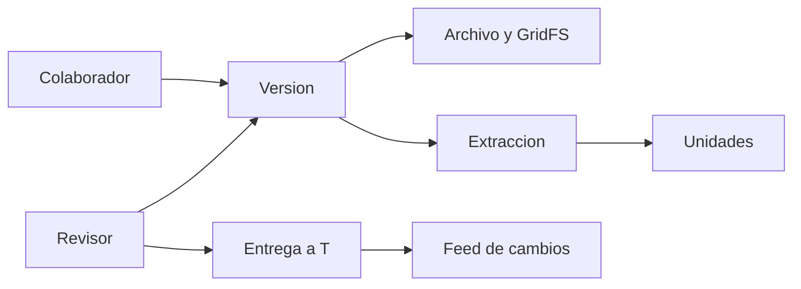

# Modelo, estados e índices

Una ficha lógica (`documents`) agrupa versiones. Cada versión apunta a un original. Una extracción nueva no crea otra versión: reprocesar el mismo original crea otra extracción. La entrega apunta a una versión y a una extracción concretas. Si cambian metadatos relevantes, la entrega anterior se revoca; no se reescribe.

## Colecciones

`users`, `documents`, `versions`, `sources`, `files`, `extractions`, `extraction_units`, `jobs`, `reviews`, `audit_events`, `handoffs`, `change_events`, `upload_requests`, `discrepancies`.

Los identificadores públicos son UUID en texto. El `ObjectId` solo lo usa GridFS y no sale en el JSON.

## Índices que crea `docia-e init-indexes`

- `users.login_normalized` único.
- `documents (center_id, profile, logical_key)` único solo cuando `identity_resolved` es verdadero.
- `versions (document_id, ordinal)` único y `(document_id, file_id)` único.
- `files (center_id, purpose, sha256)` único para originales.
- `extractions (version_id, config_fingerprint, attempt)` único.
- `extraction_units (extraction_id, unit_id)` único.
- `upload_requests (actor_id, idempotency_key)` único.
- `jobs.request_key` único, más `(state, lease_until, created_at)`.
- `handoffs.version_id` único solo mientras `status` es `ready`.
- `change_events.sequence` único.

El índice no autoriza. Un duplicado de otro centro no devuelve título ni enlace.

## Escritura

1. El archivo se valida y se hashea por bloques en un temporal privado.
2. Se reserva la ficha del original en estado `staging`.
3. Se escribe en GridFS y se vuelve a leer el hash.
4. Una transacción crea la versión, la fuente y marca el archivo `ready`.
5. El temporal se borra. Si el paso 4 no confirma, el archivo no queda listo. `docia-e reconcile` lista esos casos y, con `--apply`, borra solo los que no tienen referencias ni un trabajo activo.

El worker reclama trabajos con arrendamiento y un token creciente. Si pierde el arrendamiento, su confirmación no se guarda.
